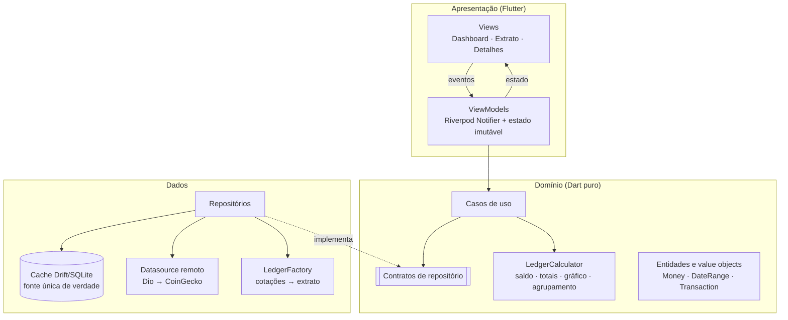
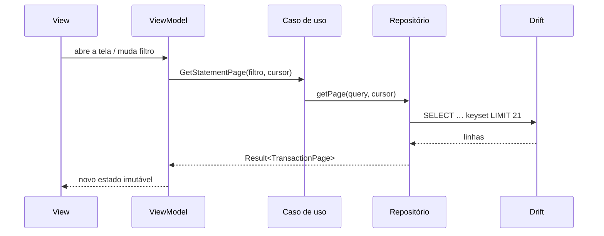
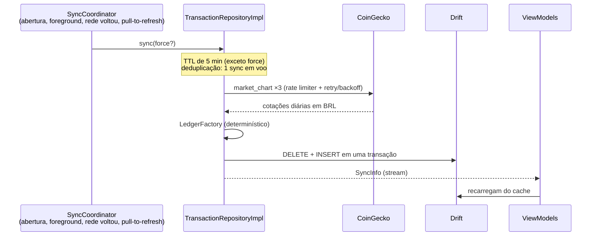

# Arquitetura

## Visão geral

MVVM com três camadas, organizado por funcionalidade (*feature-first*):



**Regra de dependência:** `apresentação → domínio ← dados`. O domínio não importa Flutter, Dio,
Drift nem a camada de dados; [`test/architecture_test.dart`](../test/architecture_test.dart) falha
se alguém quebrar a regra.

```
lib/
├── app/          composição (DI), rotas, tema, coordenador de sincronização
├── core/         Result/Failure, Money, datas e fuso, rede, logs, configuração
├── features/
│   ├── ledger/        domínio + dados do extrato (compartilhados pelas telas)
│   ├── dashboard/     apresentação
│   ├── statement/     apresentação
│   ├── transaction_details/
│   └── preferences/   ocultar saldo (domínio + dados)
└── shared/       componentes visuais e textos comuns
```

## Fluxo de dados

**Leitura — sempre do cache:**



**Sincronização — rede → cache → telas:**



## Gerenciamento de estado: Riverpod 3

- `Notifier` é o ViewModel; o estado é uma classe imutável (`freezed`) com `copyWith`.
- Providers fazem também a injeção de dependência: a raiz de composição é
  [`app/providers.dart`](../lib/app/providers.dart); testes e flavors trocam implementações com
  `overrideWithValue`.
- `ref.listen` no stream de `SyncInfo` faz as telas recarregarem quando chegam dados novos, sem
  reconstruir o ViewModel (filtros e páginas do extrato não se perdem).
- Alternativas e motivo da escolha: [ADR-0002](adr/0002-gerenciamento-de-estado-riverpod.md).

## Consistência dos valores

- Dinheiro é `Money(int centavos)`; `Decimal` aparece apenas na conversão quantidade × preço,
  com arredondamento *half-even* ([ADR-0004](adr/0004-dinheiro-em-centavos.md)).
- **Fonte única de verdade:** as três telas leem só do banco local. O dashboard calcula saldo,
  totais, gráfico e últimas transações a partir de **uma única leitura** (`getAll`), então os
  números não podem divergir entre si.
- As regras financeiras vivem em [`LedgerCalculator`](../lib/features/ledger/domain/services/ledger_calculator.dart),
  e a formatação em um só componente (`AmountText`), usado no dashboard, no extrato e nos detalhes.
- Cada sincronização substitui o cache atomicamente; leitores nunca veem um estado misturado.

## Estratégia de cache

| Situação | Comportamento |
|----------|---------------|
| Abrir o app | Mostra o cache na hora; sincroniza em segundo plano se o TTL (5 min) expirou |
| Pull-to-refresh | Força a sincronização (ainda deduplicada e com rate limit) |
| App volta ao foreground / rede volta | Sincroniza se o TTL expirou |
| Sync falha com cache | Mantém os dados, mostra banner com a data da última atualização |
| Cache com mais de 15 min | Banner "os dados podem estar desatualizados" |
| Sem cache e sem rede | Estado "Sem conexão" com "Tentar novamente" |

## Tratamento de erros

- Datasources lançam exceções tipadas ([`app_exceptions.dart`](../lib/core/errors/app_exceptions.dart));
  repositórios são a única fronteira que as converte em `Failure` e devolvem `Result<T>`.
- ViewModels fazem `switch` exaustivo sobre `Success`/`Err`; textos ao usuário vêm de
  [`describeFailure`](../lib/shared/failure_messages.dart), nunca da exceção.
- Erros fora da árvore de widgets vão para `FlutterError.onError` e
  `PlatformDispatcher.onError` (ponto de integração para Crashlytics/Sentry).

## Performance

- Listas com `CustomScrollView` + `SliverList.builder` (construção sob demanda) e cabeçalhos de
  dia fixos (`PinnedHeaderSliver` dentro de `SliverMainAxisGroup`).
- Paginação por cursor (20 itens), disparada a 600 px do fim; `loadMore` ignora chamadas
  concorrentes. O agrupamento por dia é recalculado só quando os itens mudam.
- Rebuilds controlados com `ref.watch(provider.select(...))` onde só uma parte do estado importa;
  formatadores de data compilados uma vez.
- Orçamento de rede: 3 requisições por sincronização, no máximo uma a cada 5 minutos fora do
  pull-to-refresh; cotação dos detalhes em cache por 60 s.

## Trade-offs e limitações conhecidas

- **Extrato derivado:** a CoinGecko não tem extrato bancário; o app deriva um extrato
  determinístico de cotações reais ([api-mapping.md](api-mapping.md)). Em produção, viria de um
  backend próprio.
- **Agregações em Dart:** com ~1 mil linhas é instantâneo; com milhões, os somatórios iriam para
  SQL (`SUM`) e o cache teria retenção.
- **Chave da API no binário:** `--dart-define` não protege segredos contra engenharia reversa;
  aceitável para a chave Demo gratuita, inaceitável para chaves pagas (usar um proxy backend).
- **Histórico:** o plano gratuito limita a 365 dias; depois disso o início do extrato avança.
- **iOS:** compila, mas não foi validado em dispositivo (o alvo de entrega é o APK Android).
